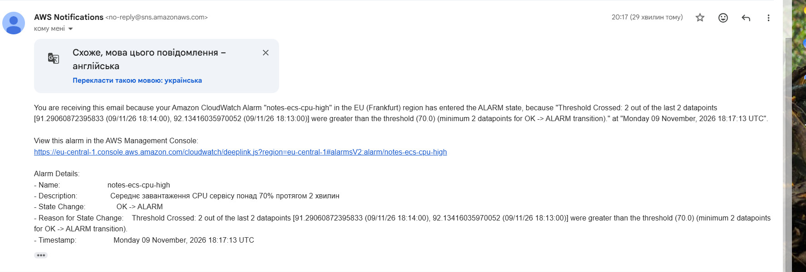
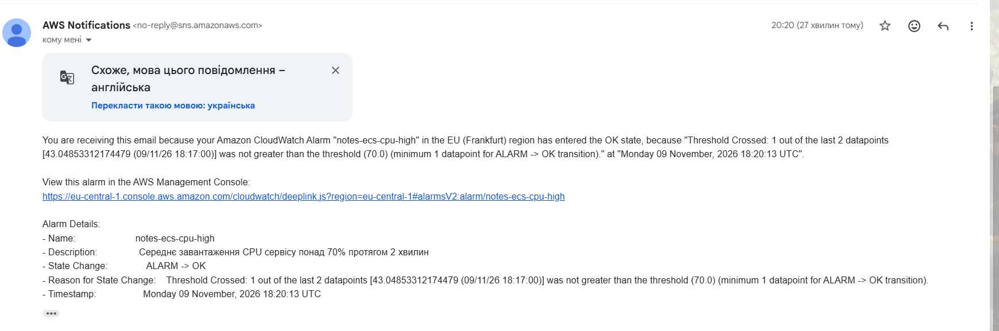

# Сповіщення

## Умова

**Середнє завантаження CPU сервісу понад 70% протягом 2 хвилин.**

Файл `infra/monitoring.tf`, ресурс `aws_cloudwatch_metric_alarm.ecs_cpu_high`:

| Параметр | Значення |
|---|---|
| Метрика | `AWS/ECS` `CPUUtilization`, статистика Average, виміри ClusterName + ServiceName |
| `period` | 60 с |
| `evaluation_periods` / `datapoints_to_alarm` | 2 / 2 — дві хвилинні точки поспіль |
| `threshold` | 70 |
| `alarm_actions` | SNS-топік `notes-alerts` → лист «ALARM» |
| `ok_actions` | той самий топік → лист «OK» при поверненні до норми |
| `treat_missing_data` | `notBreaching` — коли метрики нема, вважаємо, що все гаразд |

Канал доставки: `aws_sns_topic.alerts` і `aws_sns_topic_subscription.email` з протоколом `email`. Адреса задається в `terraform.tfvars` (`alert_email`). Після першого `apply` треба натиснути «Confirm subscription» у листі від AWS, інакше SNS нічого не надсилатиме.

## Обґрунтування

- Ціль автомасштабування — 60%. Якщо CPU тримається вище 70% дві хвилини, масштабування поки не справляється: нові копії ще не стартували або вже досягнуто максимуму в 3 копії. Саме тоді людині варто подивитися на сервіс.
- 70% вище за 60%, тому звичайне додавання копії лист не викликає, і скринька не засмічується.
- Дві хвилини замість однієї точки захищають від короткого стрибка CPU, наприклад при старті контейнера чи одному важкому запиті. Без цього алерт перемикався б ALARM ↔ OK кожну хвилину (flapping).
- `ok_actions` надсилає другий лист, коли проблема минула, і на нього не треба дивитися вручну.

## Листи під час прогону

Прогін з `docs/LOADTEST.md`, N = 20, 09.11.2026, київський час.

| Подія | Час |
|---|---|
| Початок навантаження (розгін) | 20:11:07 |
| Початок сталого навантаження | 20:13:37 |
| CPU вперше вище 70% (хвилинні точки 20:13 і 20:14: 92% і 91%) | 20:13 |
| Лист ALARM | 20:17:13 |
| Друга копія почала обробляти запити, CPU впав до 43% | ~20:18 |
| Лист OK | 20:20:13 |
| Кінець навантаження | 20:20:39 |

Від початку сталого навантаження до першого листа минуло **3 хв 36 с**. Від першої хвилини з CPU > 70% — близько 4 хв.

Лист OK прийшов ще до кінця тесту, і це правильно: проблема зникла, коли автомасштабування додало другу копію. Тобто сповіщення повідомило і про перевантаження, і про те, що система сама з ним впоралась.

## Із чого складається затримка

1. До 1 хв: ECS агрегує CPU за хвилину і публікує точку в CloudWatch.
2. 2 хв: потрібні дві точки поспіль вище 70%.
3. До ~1 хв: CloudWatch оцінює алерт періодично, а не миттєво.
4. Секунди: SNS надсилає лист, поштовий сервер його доставляє.

Разом ~3–4 хв від початку проблеми до листа.

## Чи прийнятний такий час реакції

Для навчального сервісу і для внутрішніх сервісів — так. Масштабування реагує за той самий час, і часто проблема зникає ще до того, як людина відкриє лист.

Для реального сервісу з користувачами 3–4 хв — нижня межа прийнятного, але сама умова не найкраща:

- CPU — це причина, а не симптом. Користувач відчуває латентність і помилки, а не CPU. Корисніше сповіщення на p95 > 500 мс або на частку 5xx: воно не спрацює, якщо CPU високий, але сервіс відповідає швидко, і спрацює, якщо CPU низький, а сервіс повільний через базу.
- Лист — повільний канал. Для чергового інженера краще Slack, PagerDuty або дзвінок.
- Метрики з періодом 10 с (high-resolution) скоротили б затримку до ~1 хв, але коштують дорожче.
