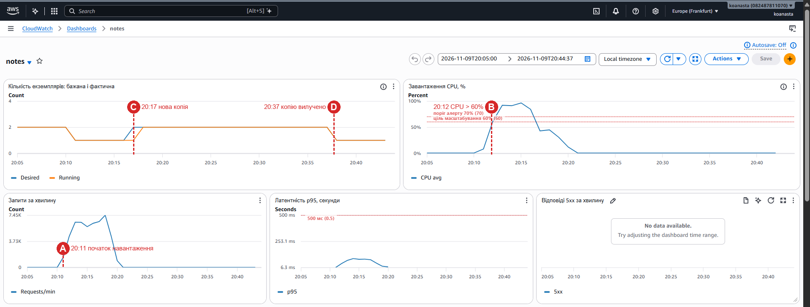

# Автоматичне масштабування

## Політика

Файл `infra/autoscaling.tf`.

| Параметр | Значення | Де задано |
|---|---|---|
| Тип політики | Target tracking | `aws_appautoscaling_policy.cpu` |
| Метрика | `ECSServiceAverageCPUUtilization` — середній CPU усіх копій сервісу | |
| Цільове значення | 60% | `var.cpu_target` |
| Мінімум копій | 1 | `var.min_instances` |
| Максимум копій | 3 | `var.max_instances` |
| Cooldown на додавання | 60 с | `scale_out_cooldown` |
| Cooldown на вилучення | 120 с | `scale_in_cooldown` |
| Розмір однієї копії | 0.25 vCPU, 512 МБ | `aws_ecs_task_definition.app` |

Target tracking працює як термостат: AWS сам створює два CloudWatch-алерти і підтримує середній CPU біля 60%.

- **AlarmHigh** — CPU > 60% три хвилини поспіль → додати копії.
- **AlarmLow** — CPU < 54% (90% від цілі) п'ятнадцять хвилин поспіль → прибрати копію.

Кількість нових копій рахується пропорційно: якщо при 1 копії CPU = 120%, то потрібно 120 / 60 = 2 копії.

`desired_count` сервісу додано в `ignore_changes`, бо після запуску кількістю копій керує автомасштабування, а не Terraform. Інакше кожен `terraform apply` скидав би сервіс назад до 1 копії.

## Чому ціль 60%

- Нова копія Fargate з'являється не миттєво, а через 2–4 хвилини: треба дочекатися метрики, створити мережевий інтерфейс, завантажити образ з ECR, запустити контейнер і пройти дві перевірки здоров'я ALB. Увесь цей час навантаження тримають наявні копії. 40% запасу дозволяють пережити цей проміжок, поки CPU не дійшов до 100%. Саме на 100% черга запитів росте і латентність різко погіршується.
- При цілі 80–90% запасу майже нема: до появи нової копії сервіс уже перевантажений.
- При цілі 30–40% копії здебільшого простоюють, а ми платимо за 2–3 копії там, де вистачило б однієї.
- Поріг алерту (70%, `docs/ALERTS.md`) навмисно вищий за ціль: алерт має спрацювати, коли масштабування не встигає, а не при кожному нормальному додаванні копії.

## Період стабілізації (cooldown)

Cooldown — час після зміни кількості копій, протягом якого політика не робить наступну зміну в той самий бік. Нові копії стартують і лише поступово забирають частину навантаження. Без паузи метрика ще якийсь час показує старе, високе значення, і політика вирішила б, що копій досі мало.

- `scale_out_cooldown = 60` — після додавання копії хвилину не додаємо наступну.
- `scale_in_cooldown = 120` — після вилучення дві хвилини не вилучаємо ще одну. Вилучення робимо обережніше, бо помилка тут боляче б'є по користувачах.

**Якщо cooldown = 0:**

1. Політика реагує на застарілу метрику, яка ще не врахувала нову копію. Вона додає ще й ще, доки не дійде до максимуму, хоча вистачило б 2 копій. Це перевитрата грошей.
2. Коли надлишкові копії запрацюють, CPU різко падає, і політика так само швидко їх прибирає. Навантаження знову лягає на одну копію, CPU росте — і все повторюється. Кількість копій постійно скаче вгору-вниз (flapping, нестабільне спрацьовування).
3. Кожне вилучення обриває частину запитів і змушує ALB перерозподіляти трафік, а кожне додавання — це холодний старт. Користувачі бачать стрибки латентності і помилки.

## Що відбувається з запитами при вилученні копії

1. Автомасштабування зменшує desired count, ECS вибирає копію для зупинки.
2. ALB знімає її з target group і перестає надсилати **нові** запити. Запити, які вже обробляються, мають до 30 с, щоб завершитися (`deregistration_delay = 30` в `infra/alb.tf`).
3. ECS надсилає контейнеру SIGTERM. Uvicorn перестає приймати з'єднання, доробляє поточні запити (до 20 с, `--timeout-graceful-shutdown 20` у `Dockerfile`), закриває пул з'єднань з базою і завершується. Це видно в логах: `SIGTERM received, finishing in-flight requests and closing DB pool`.
4. Якщо контейнер не завершився за 30 с (`stopTimeout = 30`), ECS надсилає SIGKILL.

## Що дозволяє масштабувати застосунок горизонтально

Застосунок не має стану всередині копії. Нотатки лежать у RDS, кеш і лічильники — у спільному Redis. Будь-яка копія може обробити будь-який запит, тому ALB розподіляє запити по колу, без «липких» сесій.

Горизонтальне масштабування стало б неможливим, якби застосунок:

- зберігав дані у файлах на диску контейнера або в змінних процесу (наприклад, сесії в словнику Python);
- тримав кеш тільки в пам'яті процесу: копії бачили б різні дані;
- виконував фонові задачі за розкладом усередині кожної копії: при 3 копіях задача запускалася б тричі.

## Панель моніторингу

Файл `infra/monitoring.tf`, ресурс `aws_cloudwatch_dashboard.main`. Посилання: `terraform output dashboard_url`.

| Графік | Метрика |
|---|---|
| 1. Кількість екземплярів | `ECS/ContainerInsights` `DesiredTaskCount` і `RunningTaskCount` (на кластері увімкнено `containerInsights`) |
| 2. CPU | `AWS/ECS` `CPUUtilization`, лінії на 60% (ціль) і 70% (алерт) |
| 3. Запити за хвилину | `AWS/ApplicationELB` `RequestCount`, Sum за 60 с |
| 4. Латентність p95 | `AWS/ApplicationELB` `TargetResponseTime`, статистика p95 |
| 5. Відповіді 5xx | `AWS/ApplicationELB` `HTTPCode_Target_5XX_Count` |

Додатково на панелі: CPU, з'єднання та IOPS бази (для `docs/CACHE.md`), стан алертів і останні логи.

### Знімки під час прогону

Прогін з кешем, `USERS=20` (див. `docs/LOADTEST.md`), 09.11.2026, київський час.

| Позначка | Час | Що видно |
|---|---|---|
| A — початок навантаження | 20:11 | графік запитів починає рости |
| B — перетин порогу CPU 60% | 20:12 | CPU 61%, далі 92–96% |
| C — поява нового екземпляра | 20:17 | рішення автомасштабування «Setting desired count to 2» о 20:17:02, Running = 2 приблизно о 20:18 |
| D — вилучення екземпляра | 20:37 | «Setting desired count to 1» о 20:37:30 |

На початку графіка кількість екземплярів дорівнює 2: це копія, що лишилась після пробного прогону. Вона вилучилась о 20:10:30, перед стартом.

Від B до C минуло **5 хв**. Навантаження закінчилось о 20:20:39, копію вилучено о 20:37:30, тобто **через 17 хв**. Після появи другої копії CPU впав з ~96% до ~43–45%.

Загальний вигляд панелі за обидва прогони (пробний о 19:48 і основний о 20:11): `img/dashboard-overview.png`. Графіки бази під час основного прогону: `img/dashboard-run-db.png`.

### Чому копія з'являється не одразу після перетину порогу

1. ECS публікує CPU раз на хвилину, і метрика з'являється в CloudWatch із затримкою ~1 хв.
2. AlarmHigh потребує 3 точок вище цілі поспіль, тобто 3 хв.
3. Після рішення Fargate виділяє ресурси і створює мережевий інтерфейс (~30 с), завантажує образ з ECR через NAT і запускає контейнер (~30–60 с).
4. ALB надсилає трафік тільки після двох успішних перевірок `/health` з інтервалом 15 с (~30 с).

Разом це 3–5 хвилин від перетину порогу до копії, яка реально обробляє запити.

### Чому вилучення відбувається значно пізніше за падіння навантаження

1. AlarmLow потребує **15** хвилин поспіль нижче 54%. AWS навмисно робить зменшення повільним: якщо навантаження повернеться через 5 хвилин, копію довелося б знову створювати з холодним стартом.
2. Між кроками вилучення діє `scale_in_cooldown` = 2 хв, тому з 3 до 1 копії йде в два кроки.
3. Кожна копія ще до 30 с доробляє поточні запити (deregistration delay).

Тому копії зникають приблизно через 15–20 хвилин після спаду навантаження. Після кожного тесту треба дочекатися, поки на графіку 1 знову буде 1 копія.
