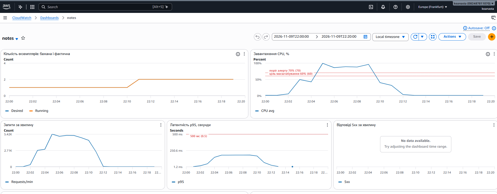

# Асинхронна обробка через чергу

## Що зроблено

Операція запису `POST /notes` може виконуватися асинхронно через Amazon SQS.

```
Клієнт ──POST /notes──▶ API ──SendMessage──▶ SQS notes-jobs ──ReceiveMessage──▶ Обробник (notes-worker)
   ▲  Prefer: respond-async │                       │                                  │
   │                        │                       │ після 5 невдалих спроб            │ INSERT ... ON CONFLICT
   └──── 202 Accepted ◀─────┘                       ▼                                  ▼
         {job_id, status_url}               DLQ notes-jobs-dlq                    PostgreSQL
   │                                                                                   │
   └──GET /jobs/{id}──▶ API ──▶ Redis job:{id} ◀── статус queued / processing / done ──┘
```

- Клієнт просить асинхронну обробку стандартним HTTP-заголовком `Prefer: respond-async`. Без нього запис працює синхронно, як у лабораторній 2, і відповідає `201 Created`.
- API кладе повідомлення в чергу, записує в Redis статус `queued` і одразу відповідає `202 Accepted` з `job_id` та заголовком `Location: /jobs/{job_id}`.
- Окремий ECS-сервіс `notes-worker` — той самий образ, але команда `python -m app.worker` (`app/worker.py`). Він читає чергу пачками по 10 з long polling 10 с, записує нотатку в базу, оновлює статус на `done` і лише після цього видаляє повідомлення з черги.
- Обробка штучно сповільнена (`WORKER_DELAY_MS = 300`), щоб імітувати тривалу операцію і побачити ріст черги.

## Terraform

`infra/queue.tf`:

| Ресурс | Призначення |
|---|---|
| `aws_sqs_queue.jobs` | основна черга, visibility timeout 60 с, long polling 10 с |
| `aws_sqs_queue.dlq` | dead-letter queue: повідомлення, яке не вдалося обробити 5 разів, переходить сюди, а не крутиться вічно |
| `aws_iam_role.app_task` | роль контейнера API: лише `sqs:SendMessage` на одну чергу |
| `aws_iam_role.worker_task` | роль обробника: лише `ReceiveMessage`, `DeleteMessage`, `ChangeMessageVisibility` |
| `aws_ecs_service.worker` | обробник, без балансувальника |
| `aws_appautoscaling_policy.worker_queue` | target tracking за `ApproximateNumberOfMessagesVisible`, ціль 20 повідомлень, 1–3 обробники |

Ролі розділені за принципом найменших привілеїв: API не може читати чергу, обробник не може в неї писати.

На дашборді додано рядок «Черга»: кількість повідомлень, що чекають, і оброблених за хвилину; кількість обробників (бажана і фактична); вік найстарішого повідомлення та кількість повідомлень у DLQ.

## Демонстрація

```
k6 run -e BASE_URL=http://<ALB> -e USERS=20 -e ASYNC=1 -e RESULT=async loadtest/notes.js
```

`ASYNC=1` додає до кожного запису `Prefer: respond-async` та `Idempotency-Key`. Після `202` сценарій один раз читає `/jobs/{id}`, і якщо задача вже `done`, читає створену нотатку.

Один обробник з затримкою 300 мс обробляє ~3 повідомлення/с, а 20 користувачів створюють ~12 записів/с. Черга росте, і автомасштабування додає обробників.

Результати прогону:

| Показник | Синхронний запис (лаб. 2, з кешем) | Асинхронний запис |
|---|---|---|
| p95 `POST /notes` | __ мс | __ мс |
| p95 усіх запитів | 164 мс | __ мс |
| Максимум повідомлень у черзі | — | __ |
| Максимум обробників | — | __ |
| Час, поки черга спорожніла після кінця навантаження | — | __ хв |



Що видно на панелі: латентність API не зростає разом із чергою, бо API лише кладе повідомлення в SQS (кілька мілісекунд), а повільна операція відбувається в обробнику. Черга росте, обробників стає більше, після кінця навантаження черга спорожнюється, і обробники вилучаються.

## Що змінилося для клієнта

- **Відповідь `202 Accepted` замість `201 Created`.** 201 означає «ресурс створено, ось він». 202 означає «запит прийнято, але ще не виконано». У відповіді немає `id` нотатки, лише `job_id`.
- **Результат стає відомим пізніше.** Клієнт дізнається його опитуванням (polling) `GET /jobs/{job_id}` з адреси `Location` або `status_url`. Статуси: `queued` → `processing` → `done` (з `note_id`). Альтернативи опитуванню — webhook на адресу клієнта, WebSocket або Server-Sent Events.
- **Eventual consistency.** Одразу після `202` нотатки ще немає в базі. Якщо клієнт одразу прочитає `GET /notes`, він її не побачить.
- **Помилку валідації бізнес-логіки клієнт дізнається не у відповіді на POST,** а пізніше, зі статусу задачі. Тому синтаксичну перевірку (Pydantic) API все одно робить синхронно, ще до черги.

## Доставка «щонайменше один раз»

SQS Standard гарантує, що кожне повідомлення буде доставлене **щонайменше один раз**, але іноді може бути доставлене двічі:

- обробник отримав повідомлення, записав нотатку, але впав (або його вилучило масштабування) до `DeleteMessage`. Через 60 с (visibility timeout) повідомлення знову стає видимим і його отримає інший обробник;
- SQS зберігає копії на кількох серверах, і зрідка одна з них віддається повторно.

«Щонайбільше один раз» означало б: видалити повідомлення до обробки. Тоді падіння обробника = втрачений запис. Черги обирають «щонайменше один раз», бо дубль можна виявити й відкинути, а втрачене повідомлення вже не повернути.

## Що буде при повторній обробці

Без захисту повторна обробка створила б **дві однакові нотатки**. Захист — ідемпотентний обробник:

- кожне повідомлення має `job_id`, і він записується в колонку `notes.request_id` з обмеженням `UNIQUE`;
- обробник робить `INSERT ... ON CONFLICT (request_id) DO NOTHING RETURNING id`. Якщо рядок уже є, вставки не буде, обробник бере `id` наявного рядка, ставить статус `done` і видаляє повідомлення;
- у статистиці `/stats` такі випадки рахуються в `jobs_duplicates`, у логах — `job ... already processed`.

Перевірено локально з ElasticMQ (SQS-сумісна черга): те саме повідомлення надіслано двічі, у базі один рядок, у логах `job dup-test-1 already processed, note 5`.

Якщо повідомлення падає 5 разів поспіль (наприклад, база недоступна), воно переходить у DLQ, і його можна розібрати вручну.

## Коректне завершення обробника

Обробник ловить SIGTERM: дочитує поточну пачку, не бере нову і закриває з'єднання з базою. Long polling 10 с вкладається у `stopTimeout = 30`. Перевірено: `SIGTERM received, finishing current batch` → `worker stopped` за 2 с. Навіть якщо обробник вбито посеред повідомлення, воно не видалене і повернеться в чергу.
